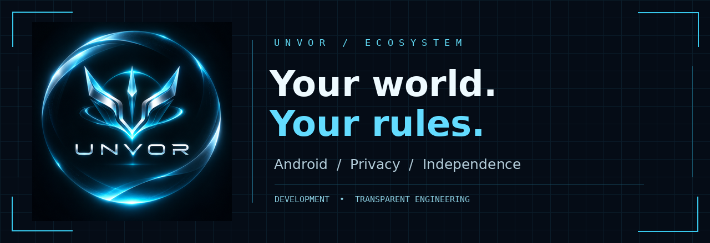
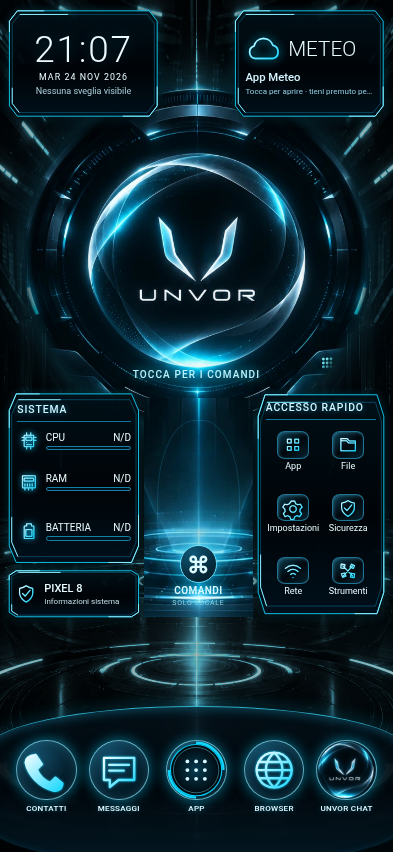

**An independent digital ecosystem for Android.**

**Digital autonomy / Engineering transparency / Independent infrastructure**

[Release catalog](releases/catalog.json) · [Engineering standards](docs/ENGINEERING.md) · [Verification dashboard](docs/STATUS.md)

[**Web portal source**](index.html) · [**Download**](docs/DOWNLOADS.md) · [**Documentation**](docs/README.md) · [**Roadmap**](docs/ROADMAP.md) · [**Security**](SECURITY.md)

English · [Italiano](docs/README.it.md) · [Español](docs/README.es.md)

---

## One ecosystem. Three core projects.

<table><tr><td width="55%" valign="top">
<h3>UNVOR Launcher</h3>

A custom Android home experience with a coherent cyan HUD, local tools and quick access to applications. Designed with GrapheneOS as the reference platform, without replacing its security mechanisms.

<a href="docs/LAUNCHER.md">Explore the Launcher →</a>

<h3>UNVOR Chat</h3>

Android messaging with an internal contact model and a goal of reducing dependence on mandatory centralized services.

<a href="docs/CHAT.md">Explore Chat →</a>

<h3>UNVOR Network</h3>

A relay federation project intended to support independently operated nodes without a blockchain. Network and retention properties require deployment-specific verification.

<a href="docs/NETWORK.md">Explore the network →</a>

</td><td width="45%" align="center" valign="top"> Launcher 112 · Project-supplied interface preview</td></tr></table>

## Download UNVOR

| Component | Channel | Availability |
| --- | --- | --- |
| UNVOR Chat | Pilot 366 | [View pilot release](https://github.com/Jabo86/ultron-android/releases/tag/ratchet-pilot-66) |
| UNVOR Launcher | Development | [Browse source](https://github.com/Jabo86/ultron-android/tree/fix/unvor-launcher/unvor-launcher) |
| UNVOR Network | Development | [Browse federation work](https://github.com/Jabo86/ultron-android/tree/feature/global-node-federation) |
| UNVOR Web | Static portal source | [Website source](index.html) · [Deployment guide](docs/WEB.md) |

Pilot builds are experimental, not stable production releases. A separately signed public Launcher APK has not been verified. [Read the download and verification guide](docs/DOWNLOADS.md).

## Engineering & transparency

| Engineering control | Evidence |
| --- | --- |
| Release inventory | [Machine-readable catalog](releases/catalog.json) |
| Product acceptance | [Test matrix](docs/TEST-MATRIX.md) |
| Release governance | [Publication checklist](docs/RELEASE-PROCESS.md) |
| Technical design records | [Architecture decisions](docs/decisions/README.md) |
| Verified vs. planned | [Evidence dashboard](docs/STATUS.md) |

| Guide | What you will find |
| --- | --- |
| [Architecture](docs/ARCHITECTURE.md) | Components and trust boundaries |
| [Privacy & security](docs/PRIVACY-SECURITY.md) | Design goals, known limits and evidence |
| [Development](docs/DEVELOPMENT.md) | Build prerequisites and release process |
| [Roadmap](docs/ROADMAP.md) | Milestones and acceptance criteria |
| [Licensing](docs/LICENSING.md) | Current terms and open-source transition |
| [Contributing](CONTRIBUTING.md) | How to help the project |

UNVOR is independent of GrapheneOS and is not an official GrapheneOS product. Privacy, Google-service independence and decentralized operation are design goals that require verification. No independent audit or production-readiness certification is asserted.

This repository is the public documentation hub; application source code and signed releases remain in their respective development repositories. Existing software is source-available under its current license, which restricts redistribution. The goal of an open-source ecosystem remains subject to rights and dependency review.

---

 <b>UNVOR</b> Digital autonomy · Transparent development

