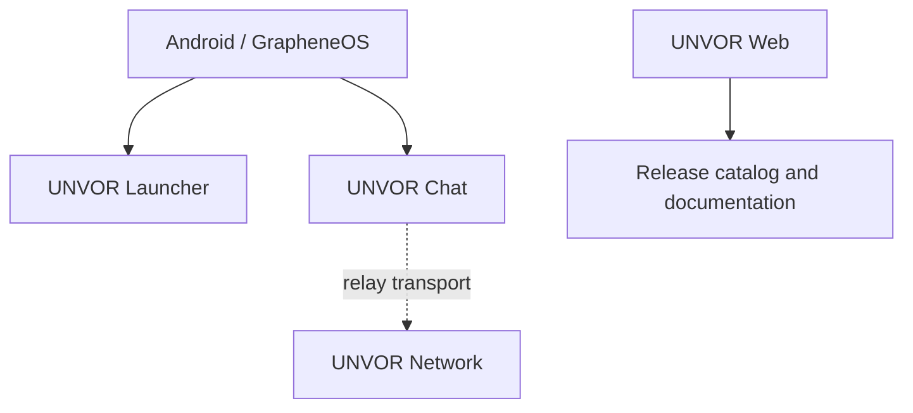

# Architecture

[Home](../README.md)

| Layer | Responsibility | Boundary |
| --- | --- | --- |
| Android / GrapheneOS | Permissions, sandbox, OS integrity | Platform security remains with the operating system |
| Launcher | Home, navigation and local tools | Respect platform permissions; keep app identities separate |
| Chat | Messaging interface, local state and protocol client | Review keys, identity, storage and transport behavior |
| Network | Relay routing and federation | Validate peer trust, retention and failure recovery |
| Web | Product information, documentation and download links | Never collect unnecessary visitor data or expose signing credentials |

The components have distinct release lifecycles. Do not treat a successful build of one component as evidence that another component is secure or available. Separate public documentation from implementation details and preserve required software attribution in the source repositories.
