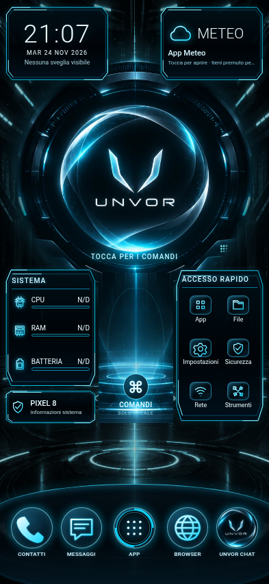

# UNVOR Launcher

[Home](../README.md) · [Source](https://github.com/Jabo86/ultron-android/tree/fix/unvor-launcher/unvor-launcher)

UNVOR Launcher is a custom Android home experience. Its design language uses cyan accents, circular application controls, a dark HUD and consistent navigation. The supplied 112 interface preview is a design reference, not evidence of every feature running on a physical device.

## Inspected source features

- Home, application drawer and configurable shortcuts.
- Local agenda: event/shift creation, update and deletion, overlap checks and reminder scheduling. Private file encrypted using AES-GCM with a key in Android Keystore.
- Vosk-based local voice recognition; packaged dependencies and device compatibility require testing.
- Navigation to UNVOR Chat, installed Android applications and Android settings via intents.
- A consistent visual language across the ecosystem.

## Platform boundaries

GrapheneOS provides operating-system security and app isolation. UNVOR should not duplicate those mechanisms or bypass user consent. Calls, files, contacts, photos and other sensitive capabilities must respect Android permissions and the user's choices. Compatibility with particular hardware and Android versions must be demonstrated.

## Release acceptance

A release needs a reproducible source reference, verified dependency provenance, package and certificate checks, upgrade and data-preservation testing, and device tests covering home navigation, settings, app launching and local functionality. Voice and wearable integrations need separate tests where applicable.

The source is available in a development branch. A separately signed public APK is not verified as of this documentation snapshot.

[Exact source review and limitations](CONTENT-EVIDENCE.md).
