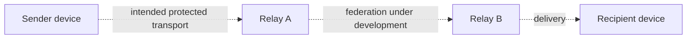

# UNVOR Network

[Home](../README.md) · [Federation development](https://github.com/Jabo86/ultron-android/tree/feature/global-node-federation)

## Purpose

The intended network consists of independent relay operators that forward messages between endpoints. The goal is to avoid a mandatory central service and a blockchain. People who do not operate a node should be able to connect through available public relays, subject to verified discovery, configuration and access controls.

## Conceptual flow

This diagram describes the design direction, not measured properties of a deployed network.

## Questions that need evidence

- How are relay identities established and authenticated? How are peer changes approved?
- What happens if a relay is unreachable or malicious?
- Which identifiers, IP addresses, delivery state and timing information are visible at each boundary?
- What data is held temporarily, written to logs, backed up or retained after delivery?
- How do retries, offline delivery and duplicate suppression interact with minimization goals?

Relays should minimize retained information. No claim of zero metadata, guaranteed availability, full decentralization or resistance to traffic correlation should be made without deployment-specific evidence. The federation branch is a development resource, not proof of a production network.
