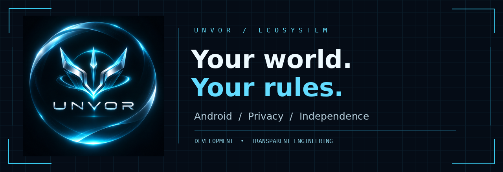

 <b>Tu mundo. Tus reglas.</b>

[English](../README.md) · [Italiano](README.it.md)

# UNVOR — Ecosistema digital independiente

UNVOR reúne una experiencia Android personalizada, un cliente de mensajería y un proyecto de infraestructura de retransmisión independiente. Su objetivo es reducir las dependencias obligatorias de servicios centralizados y hacer verificables sus decisiones técnicas.

| Proyecto | Descripción | Estado |
| --- | --- | --- |
| UNVOR Launcher | Interfaz HUD, acceso a aplicaciones y herramientas locales | [Código en desarrollo](https://github.com/Jabo86/ultron-android/tree/fix/unvor-launcher/unvor-launcher) |
| UNVOR Chat | Mensajería Android y contactos internos | [Piloto 366](https://github.com/Jabo86/ultron-android/releases/tag/ratchet-pilot-66) |
| UNVOR Network | Federación de nodos sin cadena de bloques | [En desarrollo](https://github.com/Jabo86/ultron-android/tree/feature/global-node-federation) |
| UNVOR Web | Portal multilingüe | Publicación prevista |

El lanzador toma GrapheneOS como referencia para la seguridad de la plataforma. No lo sustituye ni es un producto oficial de GrapheneOS. No se afirma anonimato absoluto, ausencia de metadatos ni seguridad certificada sin pruebas.

## Guías

[Launcher](LAUNCHER.md) · [Chat](CHAT.md) · [Red](NETWORK.md) · [Descargas](DOWNLOADS.md) · [Arquitectura](ARCHITECTURE.md) · [Privacidad y seguridad](PRIVACY-SECURITY.md) · [Desarrollo](DEVELOPMENT.md) · [Hoja de ruta](ROADMAP.md)

Las guías técnicas detalladas están actualmente en inglés. Los pilotos son experimentales. La publicación de un APK firmado del lanzador aún no se ha verificado. El código de las aplicaciones está disponible bajo una licencia con restricciones de redistribución. La transición al código abierto requiere revisar los derechos. [Detalles](LICENSING.md).
