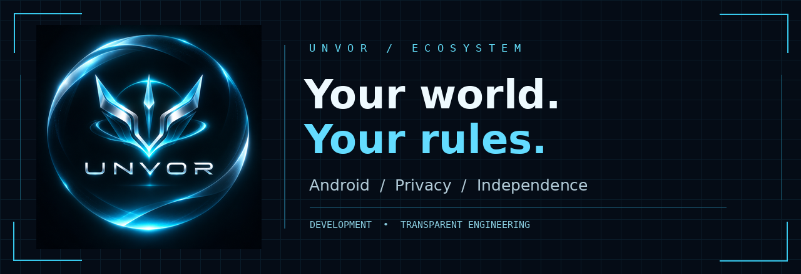

 <b>Il tuo mondo. Le tue regole.</b>

[English](../README.md) · [Español](README.es.md)

# UNVOR — Ecosistema digitale indipendente

UNVOR nasce per offrire un ambiente Android personalizzato, una messaggistica dedicata e una rete di relay gestiti in modo indipendente. L'obiettivo è ridurre le dipendenze obbligatorie da servizi centralizzati e rendere verificabili le scelte tecniche.

| Progetto | Descrizione | Stato |
| --- | --- | --- |
| UNVOR Launcher | Interfaccia HUD, accesso alle app e strumenti locali | [Sorgenti in sviluppo](https://github.com/Jabo86/ultron-android/tree/fix/unvor-launcher/unvor-launcher) |
| UNVOR Chat | Messaggistica Android e rubrica interna | [Pilota 366](https://github.com/Jabo86/ultron-android/releases/tag/ratchet-pilot-66) |
| UNVOR Network | Federazione dei relay senza blockchain | [Sviluppo](https://github.com/Jabo86/ultron-android/tree/feature/global-node-federation) |
| UNVOR Web | Portale multilingua | Pubblicazione prevista |

Il Launcher prende GrapheneOS come riferimento per la sicurezza di piattaforma: non lo sostituisce e non è un suo prodotto ufficiale. Non dichiariamo anonimato assoluto, assenza di metadati o sicurezza certificata senza verifiche.

## Guide

[Launcher](LAUNCHER.md) · [Chat](CHAT.md) · [Rete](NETWORK.md) · [Download](DOWNLOADS.md) · [Architettura](ARCHITECTURE.md) · [Privacy e sicurezza](PRIVACY-SECURITY.md) · [Sviluppo](DEVELOPMENT.md) · [Roadmap](ROADMAP.md)

Le guide tecniche di dettaglio sono attualmente in inglese. I pilota sono sperimentali. La pubblicazione dell'APK firmato del Launcher non è ancora verificata. Il codice applicativo è consultabile con una licenza che limita la redistribuzione; il passaggio a una licenza open source richiede una verifica dei diritti. [Dettagli](LICENSING.md).
